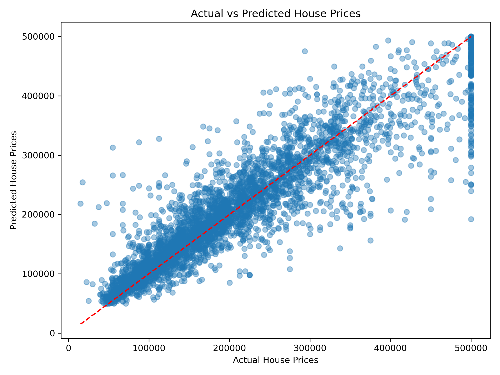
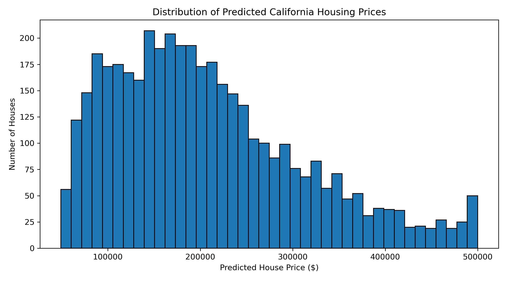

# California Housing Price Prediction 🏡

A Machine Learning project that predicts median house values in California using **Random Forest Regression**. The project covers data preprocessing, feature engineering, model training, evaluation, and visualization.

## 📌 Project Overview

The objective of this project is to build a regression model that estimates California house prices based on features such as location, median income, housing age, population, and other demographic information.

The project uses the California Housing dataset containing 20,640 records and applies a Random Forest Regressor to predict median house values.

## 🎯 Objectives

- Explore and understand the housing dataset.
- Handle missing numerical values.
- Encode categorical variables.
- Scale numerical features.
- Apply stratified train-test splitting.
- Train a Random Forest Regression model.
- Evaluate performance using regression metrics.
- Visualize actual and predicted house prices.

## 🛠️ Tech Stack

| Technology | Purpose |
|---|---|
| Python | Programming language |
| Pandas | Data manipulation |
| NumPy | Numerical operations |
| Matplotlib | Data visualization |
| Scikit-learn | Machine Learning and preprocessing |
| Joblib | Model serialization |

## 📂 Dataset

The project uses the California Housing dataset.

- Total records: 20,640
- Total features: 9 input features
- Target variable: `median_house_value`
- Categorical feature: `ocean_proximity`

### Features Used

- Longitude
- Latitude
- Housing Median Age
- Total Rooms
- Total Bedrooms
- Population
- Households
- Median Income
- Ocean Proximity

## ⚙️ Project Workflow

1. Data Loading and Exploration
2. Stratified Train-Test Splitting
3. Handling Missing Values using Median Imputation
4. Feature Scaling using StandardScaler
5. Categorical Encoding using OneHotEncoder
6. Data Transformation using ColumnTransformer
7. Model Training using RandomForestRegressor
8. Prediction on Test Data
9. Model Evaluation
10. Result Visualization

## 🤖 Machine Learning Model

**Random Forest Regressor**

The model uses an ensemble of decision trees to predict house prices.

Configuration:
- Number of estimators: 100
- Random state: 42
- Parallel processing: Enabled

## 📊 Model Performance

The model was evaluated on 4,128 unseen test records.

| Evaluation Metric | Result |
|---|---:|
| R² Score | 0.8291 |
| R² Percentage | 82.91% |
| Mean Absolute Error (MAE) | $30,929.48 |
| Root Mean Squared Error (RMSE) | $47,197.67 |

The model explains approximately 82.91% of the variation in house prices on the test dataset.

## 📈 Visualizations

### Actual vs Predicted Prices

The scatter plot compares actual house prices with the model's predicted values. Points closer to the diagonal reference line represent more accurate predictions.




### Prediction Distribution

The histogram shows the distribution of predicted house prices across the test dataset.



## 🚀 How to Run the Project

### 1. Clone the repository

```bash
git clone https://github.com/VanshPuri15/California-Housing-Price-Prediction.git
```

### 2. Navigate to the project directory

```bash
cd California-Housing-Price-Prediction
```

### 3. Install dependencies

```bash
pip install -r requirements.txt
```

### 4. Run the project

```bash
python main.py
```

The script trains the model, evaluates its performance, generates predictions, and saves the result files and visualizations.

## 📁 Project Outputs

- `predictions.csv` – Predicted house prices.
- `model_results.csv` – Actual and predicted price comparison.
- `actual_vs_predicted.png` – Actual vs predicted visualization.
- `prediction_distribution.png` – Distribution of predicted prices.

## 🔮 Future Improvements

- Compare multiple regression algorithms.
- Perform hyperparameter tuning using GridSearchCV.
- Analyse feature importance.
- Improve model performance through feature engineering.
- Develop an interactive house price prediction web application.

## 👨‍💻 Author

**Vansh Puri**

Machine Learning | Data Science | Python

GitHub: https://github.com/VanshPuri15

---

⭐ If you find this project interesting, consider giving the repository a star!